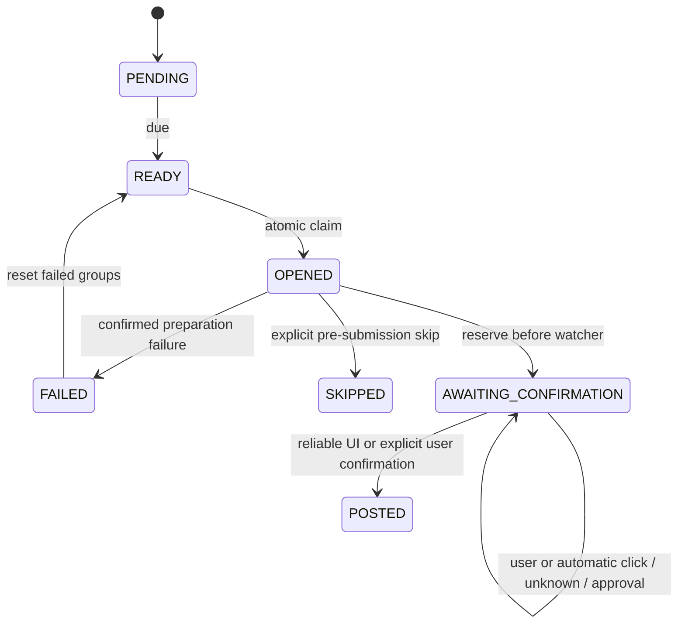

# Posting workflow

```mermaid
sequenceDiagram
participant U as User
participant W as Vercel Web App
participant DB as PostgreSQL
participant E as Chrome Extension
participant F as Facebook
U->>W: Sign in and create campaign
W->>DB: Generate scheduled queue
U->>W: Pair extension
E->>W: Request next eligible job
W->>DB: Claim job atomically
W-->>E: Group URL and caption
E->>F: Open Facebook Group
alt Facebook login or verification required
F-->>U: Show Facebook sign-in or verification
U->>F: Complete directly on Facebook
end
E->>F: Prepare caption and verify image previews
E->>W: Reserve submission (AWAITING_CONFIRMATION)
E->>F: Install trusted-click watcher
alt Automatically click Post enabled
E->>F: Click verified Post button once
else Manual Post mode
U->>F: Review and click Post directly on Facebook
end
E->>W: Record click source separately from reservation
alt Fresh publication confirmation for this group
E->>W: Confirm published (ui_confirmed)
W->>DB: Save POSTED/history once
E->>F: Open next due group
else Approval, conflicting or missing evidence
E->>U: Pause for manual review; never resubmit
U->>F: Check whether the post was really published
U->>E: Explicitly confirm only a verified publication
E->>W: Confirm published (user_confirmed)
end
```

Assisted campaigns have no fixed group-count cap. Stop monitoring stops local observation; Cancel stops server claims; Reset only affects FAILED jobs. Unknown and approval-required submissions remain AWAITING_CONFIRMATION. A reserve is not evidence that the user clicked Post, and a click is not evidence of publication.



Worker restart or lost watcher after tab reload pauses for review. The extension never automatically refills or submits an uncertain job. Uploaded preview identities are local-only; ambiguous/partial previews stop retry instead of attaching duplicate files. The prepared counter counts preparation/reservation, not confirmed Facebook publications.

## Editing a campaign

Campaign creation uses three steps: Campaign & Content, Select Groups, and Schedule & Review. A live summary keeps the current content, chosen groups and timing visible. Previously visited steps and the summary's Edit actions retain the draft. Group filters never remove existing selections; Selected only makes it easier to review a large selection. Final submission revalidates every step and keeps the draft after a failed request.

Campaigns opens the list first when campaigns already exist. New campaign opens the form, and hiding it keeps its draft while the page stays open. Dashboard and sidebar shortcuts open `/campaigns#new` directly. After a successful save, the form closes and focus moves to the confirmation with an Open campaign link. Saving creates a READY campaign; Start remains a separate action. Dashboard setup guidance uses saved content, active groups and unexpired paired devices to identify the next missing prerequisite.

Open Campaigns, choose the campaign, then click Edit campaign. READY campaigns can be edited directly; pause a RUNNING campaign first and resolve OPENED or AWAITING_CONFIRMATION jobs before saving.

The editor supports changing the campaign name and intervals, selecting or creating content, editing caption/link, adding existing or new groups, updating group names/URLs, and removing groups from the campaign. Every saved campaign still needs one content item and at least one group. Removing the selected content clears the editor so it can be replaced with existing or new content; it does not delete library content. Group metadata is saved to the workspace immediately; campaign selection applies when Save campaign changes is clicked.

Edited captions create separate library content and copy the original images. Other campaigns keep their content. Changing content uses PRIMARY_ONLY to avoid retaining variants from the previous content. Pending jobs are rebuilt on paused campaigns; posted/skipped jobs and history are preserved. Removed failed jobs become skipped so Retry cannot publish to removed groups. A campaign with no remaining pending or selected failed jobs completes automatically.
## Deleting a campaign

Use Delete campaign in the campaign list or detail page. Confirmation explicitly warns that the campaign, selected-group links, queue and history are permanently removed. Shared library content, media, groups and actual Facebook posts are kept. The API checks the session, Origin and workspace and writes CAMPAIGN_DELETED to the audit log.

Pause a running campaign first. OPENED or AWAITING_CONFIRMATION jobs must be resolved before deletion, including in a cancelled campaign; deletion cannot erase uncertain submission evidence. This feature does not require a schema migration and does not automatically delete any existing campaigns.

## Content library images and details

The same upload controls accept JPG, PNG, WebP and PDF files, including mixed selections. The UI displays the configured per-file size limit, counts images and PDFs separately and keeps unfinished files available for retry. PDFs have a document card with Open PDF, Download PDF and Delete PDF actions rather than an image preview. PDF reads and downloads require the owning workspace session; files stay in private storage. Signature, MIME type, extension and size are checked on upload. PDFs are reference documents and are excluded from the posting extension's image attachments; they are not converted into images or posted automatically.

Each saved content row shows its persisted image count, including after reloading the page. Details opens a modal with the caption, link, saved image previews, upload control, edit/duplicate/delete actions and variants. The list stays in place behind the popup.

Choose multiple JPG, PNG or WebP images to attach them to existing content. While uploading, conflicting edits and deletion are disabled. The count increases only after each successful response. A partial failure retains the remaining selection; Retry remaining images uploads only those files, while Clear selection discards the pending selection. When creating content, selected images are counted separately from saved images and are uploaded on Save content.

Image deletion: open Details and click Delete image below a thumbnail. Confirm the filename before deletion. The API verifies Origin, session and workspace; it removes only that image and its storage file. Failed storage deletion retains metadata for retry, and the visible count changes only after success. Images copied to other content have independent storage keys and remain available. Content changes apply to library content used by campaigns; deleting a library image does not remove an already published Facebook image.

Popup editing: click Edit within an item's Details. A separate modal opens; saving updates its name, caption and link and returns to Details. Group, campaign and variant editors also open in modals. A failed save retains the draft and displays the error inside the popup. Close or Escape discards unsaved edits and returns focus to the triggering control. Background scrolling is locked, long forms scroll inside the popup, and closing is blocked while saving. Deleting content, groups, campaigns, variants or media requires confirmation; cancellation sends no delete request. Failed deletions remain open for retry. Uploading/deleting files and saving content disable conflicting actions while requests are active.

Management editors open next to their context: the Groups page shows its edit form in a full-width table row immediately below the selected group. Campaign settings contain their campaign editor, and editing a campaign group opens its form inside that group's row. The new-group form opens directly below Add a Facebook Group. Opening another group's editor resets the inputs to that group; saving refreshes the displayed row.

## Optional automatic Post

Automatically click Post defaults off and must be enabled explicitly in the popup before starting a run. The setting persists, including when the popup closes, while each run keeps its selected mode. Changing modes is disabled during a run or an unresolved submission. Trusted human clicks remain monitored even in automatic mode. An automatic click is audited separately via clickSource metadata, and only verified publication proceeds to the next due group. Unknown, approval, transport loss and worker restart preserve the reserved job for review. No uncertain result is retried automatically.
